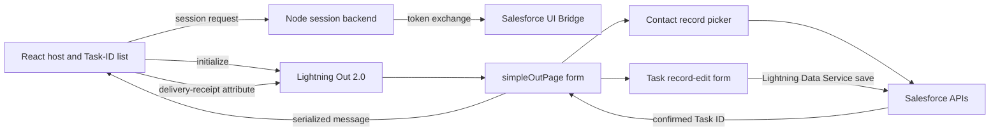
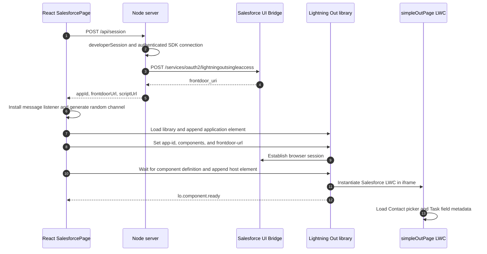
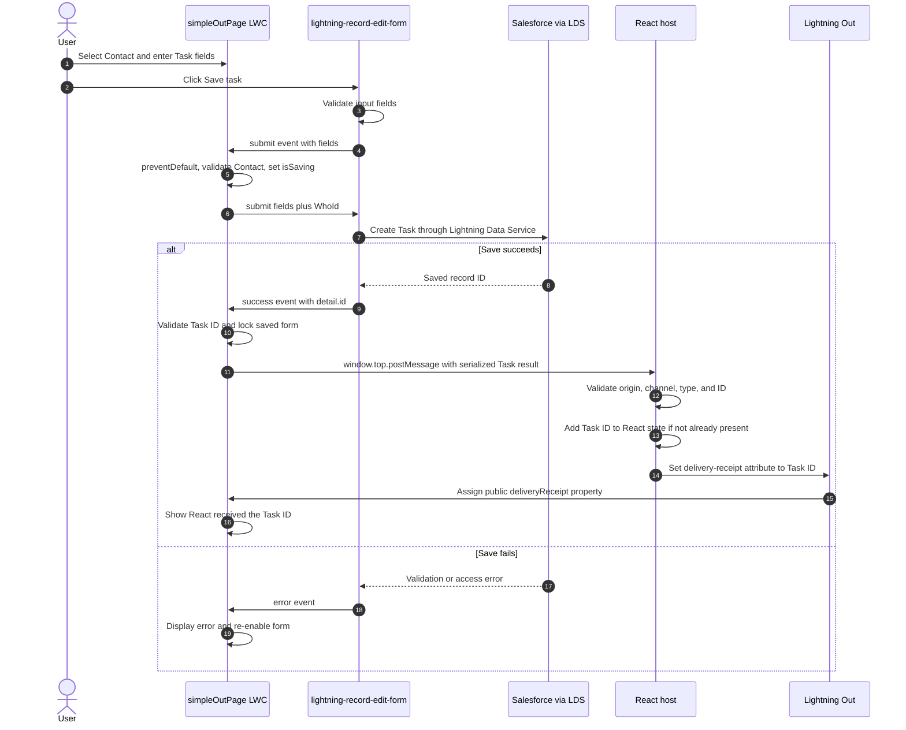

# LWC-owned Contact Task Form: React and Lightning Out 2.0

Updated November 4, 2026. This document describes the current LWC-owned form,
which replaces the earlier React prompt and Node Task-creation implementation.

## Call sequence at a glance

| Step | Trigger                                      | Component / method invoked                                                                    | Output or next call                                             |
| ---- | -------------------------------------------- | --------------------------------------------------------------------------------------------- | --------------------------------------------------------------- |
| 1    | Browser opens the React page                 | `App` renders `SalesforcePage`; its mount effect calls `connect()`                            | POST `/api/session`.                                            |
| 2    | Session request reaches Node                 | API middleware → `developerSession()` → `developerConnection()` as needed                     | Authenticated SDK connection and app ID.                        |
| 3    | Node exchanges the API token                 | `bridgeSession()` → Salesforce UI Bridge                                                      | Runtime frontdoor URL returned to React.                        |
| 4    | React receives session configuration         | `loadLibrary()`, application element creation, and `frontdoor-url` assignment                 | Salesforce browser session and component registration.          |
| 5    | Host component class is registered           | `customElements.whenDefined()` → append `c-simple-out-page`                                   | Salesforce instantiates `SimpleOutPage` in its iframe.          |
| 6    | LWC/base-component initialization            | Record picker and Task form load their Salesforce data/metadata; form `load` → `handleLoad()` | `formLoaded = true`; Save can be enabled.                       |
| 7    | User chooses a Contact                       | Record picker `change` → `handleContactChange(event)`                                         | Contact ID stored in the LWC.                                   |
| 8    | User clicks Save task                        | Form validates Task fields, then `submit` → `handleSubmit(event)`                             | `WhoId` added; `form.submit(fields)` delegates the save to LDS. |
| 9    | Salesforce accepts the create operation      | Form `success` → `handleSuccess(event)`                                                       | Confirmed `event.detail.id` stored as `savedTaskId`.            |
| 10   | Task ID has been validated                   | `publishTask()` → `window.top.postMessage()`                                                  | JSON text sent to the React origin.                             |
| 11   | React's window listener receives the message | `readTaskCreated()` → `onCreatedRef.current()` → `App.created()`                              | Deduplicated Task ID and link rendered in React.                |
| 12   | React accepts the Task ID                    | `page.setAttribute('delivery-receipt', taskId)` → Lightning Out → `deliveryReceipt` setter    | LWC displays `React received the Task ID.`                      |

Steps 4–6 contain asynchronous library, session, and field-metadata work; their
completion notifications are not all interchangeable. `lo.component.ready`
signals the embedded LWC has rendered, while the form's `load` event controls
its Save readiness. Steps 9–12 run only after a successful Task save.

## 1. Responsibilities

**The LWC creates the Task through Salesforce Lightning Data Service. React
receives the confirmed record ID. Node establishes the embed session only.**

| Component                                                                               | Runs in                  | Responsibility                                                                                              |
| --------------------------------------------------------------------------------------- | ------------------------ | ----------------------------------------------------------------------------------------------------------- |
| `App` in [src/main.jsx](src/main.jsx)                                                   | React browser context    | Renders the two panels and keeps a deduplicated list of received Task IDs.                                  |
| `SalesforcePage` in [src/main.jsx](src/main.jsx)                                        | React browser context    | Loads Lightning Out, initializes the Salesforce session, receives saved-ID messages, and acknowledges them. |
| [server.mjs](server.mjs)                                                                | Local Node process       | Serves Vite and POST `/api/session`; has no Contact or Task write route.                                    |
| [salesforce.mjs](salesforce.mjs)                                                        | Node                     | Uses the authenticated Salesforce SDK connection to obtain a runtime frontdoor URL.                         |
| `Simple_React_Demo`                                                                     | Salesforce configuration | Enabled Lightning Out app exposing `c-simple-out-page` to localhost:5174.                                   |
| [simpleOutPage.js](../../force-app/main/default/lwc/simpleOutPage/simpleOutPage.js)     | Salesforce iframe        | Coordinates Contact selection, form submission, success/errors, and Task-ID delivery.                       |
| [simpleOutPage.html](../../force-app/main/default/lwc/simpleOutPage/simpleOutPage.html) | Salesforce iframe        | Composes the record picker, record-edit form, input fields, Save, and saved-record controls.                |
| [src/task-messages.mjs](src/task-messages.mjs)                                          | React browser context    | Validates incoming message origin, channel, type, payload size, and Task ID.                                |



Plain-text equivalent:

```text
React -> Node session endpoint -> Salesforce UI Bridge
React -> Lightning Out -> LWC Contact/Task form -> LDS -> Salesforce
React <- validated Task ID message <- LWC success handler
React -> delivery-receipt attribute -> Lightning Out -> LWC acknowledgment
```

## 2. Page load and session sequence



Plain-text sequence:

```text
/api/session -> SDK -> UI Bridge -> frontdoor URL
library -> application element -> component definition -> iframe -> LWC
```

`developerConnection()` resolves `Org.create({ aliasOrUsername })`, obtains its
SDK connection, and calls `identity()` to exercise authentication/refresh. The
server uses the connection's actual token, not the redacted token from CLI display
output. If no app ID is configured, it discovers `Simple_React_Demo` using Tooling
API. The browser receives the frontdoor URL, not the API token.

The browser creates sibling `lightning-out-application` and
`c-simple-out-page` elements. It passes `host-origin` and a per-mount random
`message-channel` to the LWC. Session establishment and element registration are
asynchronous; the library loads the LWC once both are ready.

The library manages the iframe and closed shadow DOM. React does not inspect
the internal Salesforce DOM. The host currently provides a 920px iframe height
for the complete form and save-result controls.

## 3. Contact selection and Task fields

`lightning-record-picker` is configured for **Contact** only. Its Salesforce
record-search implementation handles the lookup and returns `event.detail.recordId`.
The LWC's `handleContactChange()` stores it as `contactId`.

`lightning-record-edit-form` is configured for **Task**, with no `record-id`, so
it creates a new record. Its `lightning-input-field` children expose:

| UI control              | Salesforce field                     | Behavior                                       |
| ----------------------- | ------------------------------------ | ---------------------------------------------- |
| Contact record picker   | Injected into `Task.WhoId` at submit | Required; accepts only Contact IDs.            |
| Subject input field     | `Task.Subject`                       | Required.                                      |
| Due date input field    | `Task.ActivityDate`                  | Optional date.                                 |
| Priority input field    | `Task.Priority`                      | Defaults to `Normal`; user can change it.      |
| Status input field      | `Task.Status`                        | Defaults to `Not Started`; user can change it. |
| Description input field | `Task.Description`                   | Optional task details.                         |

Object and field references are imported from `@salesforce/schema`. Salesforce
base components handle field rendering, picklist metadata, field-level access,
and native validation. The form's `load` event sets `formLoaded`; Save remains
disabled until the form has loaded.

`OwnerId` and `WhatId` are not explicitly set. Salesforce applies normal defaults
and org automation. There is no prompt parser or model call in this version.

## 4. Save and return-to-React sequence



Plain-text sequence:

```text
Save -> record-edit-form validation -> handleSubmit -> inject WhoId
     -> form.submit(fields) -> LDS -> Salesforce create
     -> success(detail.id) -> handleSuccess -> publishTask
     -> postMessage JSON -> readTaskCreated -> App.created -> React Task-ID list
     -> delivery-receipt -> LWC setter -> acknowledged delivery status
```

`handleSubmit()` cancels the default submission before performing its checks.
It prevents duplicate submissions while saving and after a successful save,
calls the Contact picker's `reportValidity()`, validates the `003...` Contact ID,
and adds `WhoId` to the form's submitted fields. Calling the form's imperative
`submit(fields)` hands the actual save back to LDS.

`handleSuccess()` reads only the primitive ID from the Salesforce success event.
It validates the `00T...` Task ID, stores it, and invokes `publishTask()`. It
does not serialize the Salesforce event object. The form handles LDS cache updates;
no Apex mutation or manual refresh operation is required here.

## 5. Message and acknowledgment contracts

### Public properties supplied by the React host

| Host attribute     | LWC `@api` property | Set when                                  | Purpose                                                                                       |
| ------------------ | ------------------- | ----------------------------------------- | --------------------------------------------------------------------------------------------- |
| `host-origin`      | `hostOrigin`        | Before the host element is appended.      | Exact destination origin for result delivery; this demo accepts only `http://localhost:5174`. |
| `message-channel`  | `messageChannel`    | Before the host element is appended.      | Random per-mount UUID used to correlate this form with its React receiver.                    |
| `delivery-receipt` | `deliveryReceipt`   | After React validates a saved-ID message. | Acknowledges the matching `savedTaskId`.                                                      |

These properties carry integration configuration and receipt state. The Task's
Contact and field values are entered inside the LWC, not passed in from React.

### LWC-to-React result

The LWC sends **a JSON string** to `window.top` with exact target origin
`http://localhost:5174`. Targeting the top-level host accommodates intermediate
security frames. No wildcard target origin is used.

```json
{
  "type": "simple-out.task-created.v1",
  "channel": "<random per-page UUID supplied by React>",
  "taskId": "00T000000000001AAA",
  "subject": "Call about renewal"
}
```

IDs above are illustrative. React's receiver accepts the message only when:

- `event.source` is present and `event.origin` matches the configured Salesforce
  My Domain origin or its corresponding Lightning origin.
- The data is a string of at most 2,048 characters and parses as JSON.
- The protocol type and channel match this mounted host.
- The Task ID has the expected `00T` prefix and 15/18-character format, and the
  subject is a string of at most 255 characters.

React constructs its record link from the trusted Salesforce origin and Task ID.
The callback updates React state, deduplicating by Task ID, and sets:

```javascript
page.setAttribute("delivery-receipt", task.taskId);
```

Lightning Out mirrors that attribute to the LWC's `@api deliveryReceipt` setter.
The LWC acknowledges only a receipt matching its saved Task ID. Save success and
delivery success are separate states: a Task can be saved even if the host does
not receive its ID.

The earlier prototype's mirrored custom-event relay encountered a
`structuredClone` error. This implementation sends plain serialized text using
browser messaging instead of forwarding Salesforce event objects.

The message's subject is captured from the submitted form fields. It is not
requeried after save, so org automation may subsequently change the actual Task
subject. The Task ID is the authoritative record reference; the record links
open Salesforce for the current record data.

## 6. Form lifecycle, failures, and retries

| Event/action                   | Invoked code                                          | Result                                                                       |
| ------------------------------ | ----------------------------------------------------- | ---------------------------------------------------------------------------- |
| Salesforce form metadata loads | `handleLoad()`                                        | Enables Save.                                                                |
| Contact selection changes      | `handleContactChange()`                               | Stores Contact ID.                                                           |
| User submits valid form        | `handleSubmit()`                                      | Sets busy state and submits Task to LDS.                                     |
| Salesforce saves               | `handleSuccess()`                                     | Stores Task ID, blocks another save, and sends ID to React.                  |
| Salesforce rejects save        | `handleError()`                                       | Displays field error, record error, or general message; clears busy state.   |
| React accepts Task ID          | React message callback, then `deliveryReceipt` setter | Displays Task ID on the left and confirms receipt in the LWC.                |
| Send Task ID to React          | `publishTask()`                                       | Resends the saved ID; does not save another record.                          |
| Create another task            | `handleNewTask()`                                     | Resets input fields, Contact selection, saved ID, errors, and receipt state. |
| Reconnect                      | `window.location.reload()`                            | Recreates session/host; clears React's in-memory list.                       |

Do not re-save a Task just because delivery is pending. Use the resend action or
the saved record link. There is no durable idempotency store: the save guard is
per LWC instance. A reload after an uncertain create outcome requires checking
Salesforce before submitting a replacement.

`lo.component.ready` means the iframe LWC rendered. The form's own `load` event
separately controls Save readiness. Neither event means a Task has been created.
The Salesforce form's `success` event is the creation signal.

The host removes its window/element listeners, aborts its pending session request,
clears its timeout, and removes host elements when unmounted. React retains saved
IDs only while the page stays open.

### Delivery troubleshooting

| Observed state                                            | What it establishes                                                           | Next check/action                                                                                                                                         |
| --------------------------------------------------------- | ----------------------------------------------------------------------------- | --------------------------------------------------------------------------------------------------------------------------------------------------------- |
| Form never appears                                        | Embedding/session initialization is incomplete.                               | Check the host status, session endpoint, allowed host, and cookie settings.                                                                               |
| Form appears but Save stays disabled                      | Form metadata has not emitted `load`, or a save/saved state is active.        | Check Salesforce form errors and whether a Task is already saved.                                                                                         |
| Save shows a field or record error                        | Salesforce has not confirmed a successful save.                               | Correct the displayed validation/access issue before retrying.                                                                                            |
| LWC shows a Task ID but React is empty                    | Save succeeded; result delivery has not been confirmed.                       | Use **Send Task ID to React**. Check the target origin, Salesforce source origin, and channel validation. Do not create another Task as a delivery retry. |
| React shows the Task ID but LWC still waits for a receipt | React accepted the result; the return property update has not been confirmed. | Check `delivery-receipt` propagation and its match to the LWC's current saved ID.                                                                         |
| Repeated delivery does not add another React row          | Receiver deduplication is working.                                            | No action; the saved record remains the same.                                                                                                             |
| React list disappears after Reconnect/reload              | The list was held in React memory only.                                       | Existing Salesforce Tasks remain saved; use Salesforce to view them.                                                                                      |

For integration debugging, inspect request status, lifecycle event names, and
the validated message shape. Do not log API access tokens, frontdoor URLs, or
entire Salesforce event objects.

## 7. Backend and configuration

The sole business-facing Node route is **POST `/api/session`**. It checks the
exact method, Origin, and Host, and returns `Cache-Control: no-store`.

| Response | Meaning                                    |
| -------- | ------------------------------------------ |
| 200      | `{ appId, frontdoorUrl, scriptUrl }`.      |
| 403      | Wrong method, host, or origin.             |
| 404      | Unknown API route after request checks.    |
| 502      | Controlled session/authentication failure. |

The old `/api/contacts` and `/api/tasks` endpoints and prompt-parser module have
been removed. Node does not perform Task DML in this design.

Current settings: org alias `aforce_de`, Lightning Out app `Simple_React_Demo`,
app ID `1UsgL0000004EArSAM`, component `c-simple-out-page`, and host
`http://localhost:5174`. `SF_TARGET_ORG` and `SF_LIGHTNING_OUT_APP_ID` configure
the session. Optional `SF_INSTANCE_URL` / `SF_ACCESS_TOKEN` override token exchange.
The LWC's allowed return origin and the server's host checks must be changed
together if the external host changes.

The local developer's bridged Salesforce user supplies the LWC execution identity.
Contact visibility, field access, and Task create permissions are enforced by
Salesforce. A shared deployment needs per-user OAuth and a production session
backend; do not publicly expose this local CLI-user session service. API tokens
stay server-side, and frontdoor URLs must be treated as sensitive session material.

Lightning Out requires browser and org cookie settings that permit its iframe.
Wrapped base components should be verified in the target org because Lightning
Out can have styling/runtime differences from native Lightning pages.

## 8. Validation and maintenance

Five LWC tests cover Contact mapping, duplicate submit guards, missing Contact,
save success and receipt, Salesforce errors, and invalid result IDs. Five Node
tests cover session exchange and receiver validation. Saves are simulated in
tests; these tests do not create production Salesforce records.

```sh
# From examples/lightning-out-react
npm test
npm run build

# From repository root
npx sfdx-lwc-jest -- --runInBand --runTestsByPath force-app/main/default/lwc/simpleOutPage/__tests__/simpleOutPage.test.js
```

React files hot-reload through Vite. Restart the server for Node or `.env` changes.
Deploy the LWC bundle for Salesforce form changes, then reload the host page.
After deployment, verify one intentional save: select a Contact, enter a subject,
save, confirm the same Task ID in the LWC and React, and confirm acknowledgment.
Use the [README](README.md) for run and deployment commands.

### Manual acceptance checklist

1. Open the host and wait for the Salesforce form and its fields to load.
2. Try saving without a Contact; confirm no Task is created.
3. Select a Contact, complete the required subject, and save once.
4. Confirm the same `00T...` record ID in the LWC and React panel.
5. Confirm the LWC displays the React receipt text.
6. Resend the ID; confirm no duplicate React row or additional Task is created.
7. Open the record link and verify its Contact and submitted Task fields.
8. Use **Create another task**; confirm the form resets and the previous React
   result remains visible until page reload.

This checklist is a live verification procedure. Passing the automated tests
does not itself establish that a real browser save or iframe delivery occurred.
